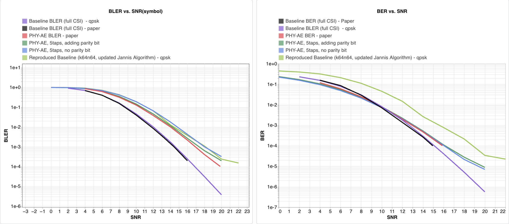

# Learning Joint Detection, Equalization and Decoding for Short-Packet Communications

[](https://pytorch.org/) [](https://wandb.ai/) [](LICENSE)

An experimental pytorch reproduction of the following paper:

> **Learning Joint Detection, Equalization and Decoding for Short-Packet Communications**<br>
> Sebastian Dörner, Jannis Clausius, Sebastian Cammerer, Stephan ten Brink, 2022.<br>
> DOI: 10.1109/TCOMM.2022.3228648

## Contents
- [Learning Joint Detection, Equalization and Decoding for Short-Packet Communications](#learning-joint-detection-equalization-and-decoding-for-short-packet-communications)
  - [Contents](#contents)
  - [1. Overview](#1-overview)
    - [Differences from the paper](#differences-from-the-paper)
    - [Results](#results)
  - [2. Installation](#2-installation)
  - [3. Repository Structure](#3-repository-structure)
  - [4. Training from Scratch](#4-training-from-scratch)
  - [5. License](#5-license)

## 1. Overview

- **Encoder:** serial outer/inner CNNs with straight-through binarization and an interleaver, mapping 64 information bits to 64 complex symbols.
- **Channel:** random five-tap Proakis-C-weighted complex fading, integer timing shifts, raised-cosine filtering with fractional sampling offsets, and AWGN.
- **Decoder:** six iterations of CNN equalization and decoding with separate weights and extrinsic-information exchange.
- **Baselines:** TensorFlow/Sionna implementations of coded modulation with BCJR equalization and Zadoff–Chu preambles, under perfect or estimated synchronization/CSI.

### Differences from the paper

- I used a smaller maximum delay (12 instead of 59)
- I assumed all messages are within the observed window, so the receiver does not need to first detect the start of the message and cutoff to a specific window.
- I trained the model using BCE rather than the paper's joint BCE + detection loss.

### Results



The simulated results are close to the paper's as shown in the figure above. 

## 2. Installation

Use Python 3.10+ and a CUDA-capable NVIDIA GPU; the current trainer selects a CUDA device directly. From the repository root:

```bash
python3 -m venv .venv
source .venv/bin/activate
python -m pip install torch numpy wandb
wandb login
```

Use a PyTorch build compatible with your CUDA environment. Baselines additionally require TensorFlow, a TensorFlow-based Sionna version exposing `sionna.phy`, and `loguru`. Dependencies are not pinned, and no lockfile is provided.

## 3. Repository Structure

```text
src/
├── models/
│   ├── SerialTurbo_AutoEncoder_key2.py     # Active encoder and iterative receiver
│   └── components/                        # CNN block and straight-through estimator
├── channel/
│   ├── Proakis_type_C_channel_new_debug.py # Fading, timing shifts, and noise
│   └── pulse_shaping_pytorch.py            # Raised-cosine filtering
├── train/
│   ├── train_PHY_AE.py                     # Entry point and configuration
│   └── trainer.py                          # Training, validation, and checkpoints
├── inference/inference_utils_TurboAE.py     # BER/BLER evaluation and parity correction
├── features/build_pytorch_dataset2.py      # Random information-bit dataset
└── baseline/                               # Sionna coded-modulation/BCJR references
LICENSE
```

## 4. Training from Scratch
Leave `pretrained=None`, set a positive `epochs` value, and run:

```bash
python src/train/train_PHY_AE.py
```

For multiple GPUs, set `use_ddp=True` in `config`:

```bash
torchrun --standalone --nproc_per_node=2 src/train/train_PHY_AE.py
```

The Slurm scripts contain cluster-specific paths and resource settings that need adapting. Use `channel="proakis_c_channel"` and `is_delay=True` for the active implementation; the remaining AWGN configuration branches are not supported by the current model.

## 5. License
This repository is partly built on top of the code from an toy example of Turbo Autoencoder shared by a author of the paper. So please cite the original paper if you use this code in your research.
